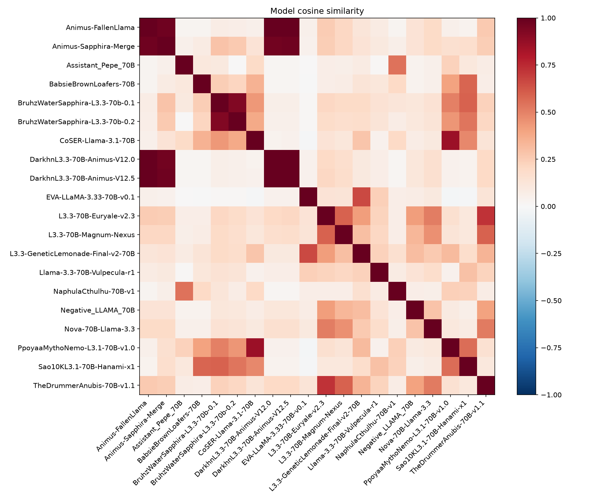
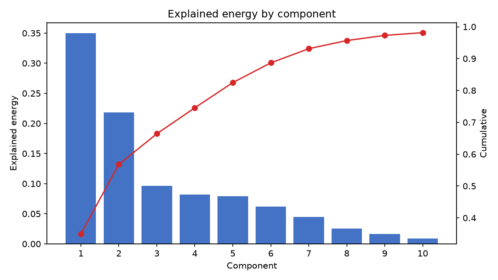
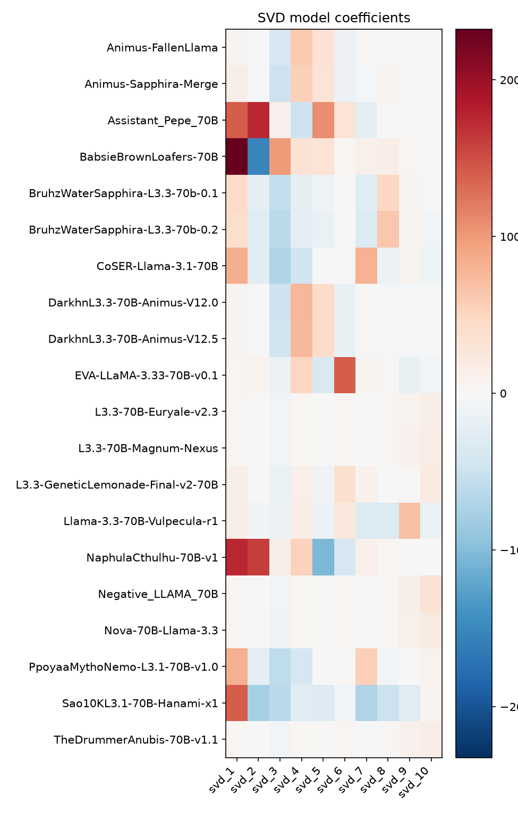
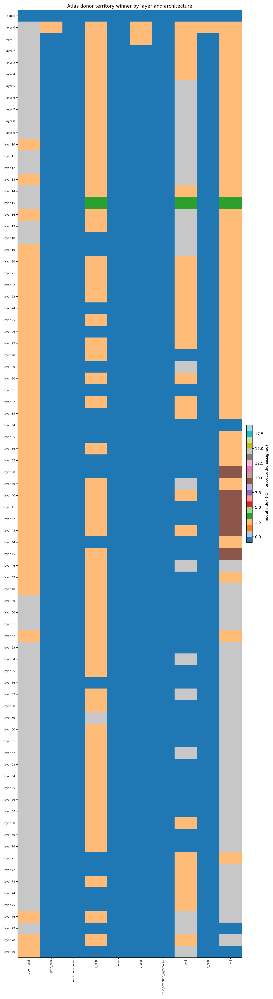
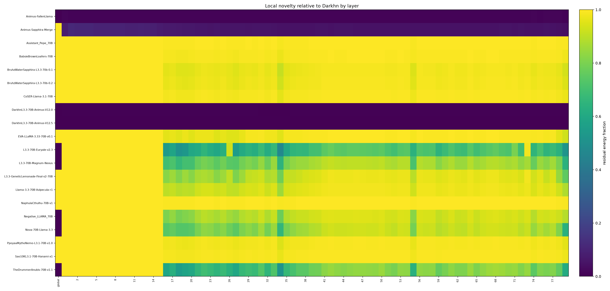

# Examples: from analysis to a merged model

This page shows real outputs from a 20-model analysis of Llama 3.3 / 3.1 70B fine-tunes against the BASE `kldzj/Llama-3.3-70B-Instruct-heretic`, and how they were used to design [Animaculus](https://huggingface.co/ArcOpening/Animaculus) and [Vulspeculatius](https://huggingface.co/ArcOpening/Vulspeculatius). All numbers come from the actual runs.

---

## 1. Reading the analysis

### Which models are similar?



Cosine similarity between every pair of deltas. A high value means two fine-tunes changed the base in a similar direction. Two models with high similarity add little to each other: merging them mostly reinforces what is already there.

### How much structure is shared?



Bars: share of the total change explained by each SVD direction. Line: cumulative share. The first few directions capture a large part of the differences across the whole collection.

### Where does each model sit?



Each row is a model, each column an SVD direction (red and blue = opposite signs). Models with the same sign and similar size on a direction share whatever that direction encodes. An unusually large row is a warning sign: one model that dominates the leading directions should not be treated like the others (see the excluded donor below).

### Where would donors land?



For a chosen departure model (here Darkhn's Animus V12.5), each cell is a layer × projection type, colored by which donor has the most novel signal there. This is what turns scores into a recipe: it tells you whether a donor would act in early attention layers, late MLP layers, and so on.



How much new signal each model has relative to the departure model, by layer. High-novelty regions are where something can be added without overwriting the departure model.

---

## 2. Scoring donors

For a chosen departure model, `atlas-analyze` computes three numbers per candidate donor and combines them:

```
score = sqrt(novelty) × (1 − conflict) / max(1, norm_ratio)
```

| Term | Meaning |
|---|---|
| `novelty` | fraction of the donor's change that lies where the departure model did not change |
| `conflict` | fraction of the donor's change that points against the departure model |
| `norm_ratio` | size of the donor's delta relative to the departure model's delta |

The last term penalizes donors whose change is much larger than the departure's own: grafting a very large edit onto a model risks overwriting it rather than adding to it. The score is a screening tool; the final decision also uses cosine similarity (is the donor *complementary*?) and the territory map (*where* does it act?).

---

## 3. Animaculus: protecting a strong identity

**Departure:** Darkhn/L3.3-70B-Animus-V12.5, a fine-tune of the BASE trained on long-form narrative, kept as the model's voice.

**Recipe:**

- 55% of the departure model's delta energy protected.
- 12 donors, each restricted to a band of layers and projection types read from its territory map:

| Band | Layers | Projections | Donors |
|---|---|---|---|
| comprehension | 0–15 | q/k/v/o | BruhzWater/Sapphira-L3.3-70b-0.1, Sao10K/Llama-3.3-70B-Vulpecula-r1, Sao10K/L3.1-70B-Hanami-x1 |
| dialogue | 4–20 | down/q/gate/up | Neph0s/CoSER-Llama-3.1-70B, Ppoyaa/MythoNemo-L3.1-70B-v1.0 |
| character | 40–65 | v | zerofata/L3.3-GeneticLemonade-Final-v2-70B, EVA-UNIT-01/EVA-LLaMA-3.33-70B-v0.1 |
| style | 60–79 | down | Sao10K/L3.3-70B-Euryale-v2.3, TheDrummer/Anubis-70B-v1.1, LatitudeGames/Nova-70B-Llama-3.3 |
| mid layers | 22–35 | all | Doctor-Shotgun/L3.3-70B-Magnum-Nexus (damped in 60–79) |
| mid + late | 20–35, 65–79 | q/k | SicariusSicariiStuff/Negative_LLAMA_70B |

- Two donors were given lower priority and strength because their own model cards mention repetition (EVA) or a tendency toward purple prose (Magnum-Nexus).
- When two donors agree in a block (cosine ≥ 0.35 and similar scores), they are blended instead of picking one.

**What the routing actually did** (blocks won, out of 163,735 open blocks; 97,385 protected):

| Donor | Blocks |
|---|---:|
| CoSER-Llama-3.1-70B | 64,152 |
| GeneticLemonade-Final-v2 | 41,200 |
| Sapphira-L3.3-70b-0.1 | 31,240 |
| Negative_LLAMA_70B | 19,199 |
| Anubis-70B-v1.1 | 4,099 |
| Vulpecula-r1 | 2,365 |
| Nova-70B | 1,282 |
| Hanami-x1 | 82 |
| Euryale-v2.3 | 74 |
| MythoNemo | 25 |
| EVA-LLaMA-3.33 | 16 |
| Magnum-Nexus | 1 |

The two down-weighted donors end up with almost no territory, which is the intended effect.

**Why Negative_LLAMA_70B was added:** score 0.957, fourth best of all 20 models; the automatic candidate builder also selected it on its own, without being told to.

**A donor that was left out:** SicariusSicariiStuff/Assistant_Pepe_70B had near-perfect novelty and no conflict, but its delta is 2.57× the size of the departure model's. That alone brings its score to 0.39, and it dominated the first two SVD directions of the whole collection with no localized territory. This is not a judgement on that model: it is a much larger change than the routing method is designed to graft safely.

---

## 4. Vulspeculatius: choosing the departure by measurement

Here the question was reversed: instead of starting from a favorite model, which departure model makes the *other* models most useful?

`atlas-analyze` was rerun with five different departure candidates (fast, since the atlas is reused). For each, we counted donors that are genuinely complementary (cosine < 0.30 to the departure) and their average score, excluding the three outliers with very large deltas:

| Departure candidate | Its delta size (vs. Animus) | Complementary donors | Avg. score |
|---|---:|---:|---:|
| TheDrummer/Anubis-70B-v1.1 | 0.28 | 11 | 0.25 |
| LatitudeGames/Nova-70B-Llama-3.3 | 0.40 | 13 | 0.41 |
| zerofata/L3.3-GeneticLemonade-Final-v2-70B | 0.59 | 10 | 0.58 |
| **Sao10K/Llama-3.3-70B-Vulpecula-r1** | **0.92** | **16 of 17** | **0.82** |
| BruhzWater/Sapphira-L3.3-70b-0.1 | 0.99 | 12 | 0.92 |

The pattern is clear: when the departure model made only a small change to the base, every donor looks large by comparison and its score drops, even if it is complementary. Departures with a typical-sized delta work best.

Sapphira scored slightly higher on average, but it is a merge built on a different base (`deepcogito/cogito-v2-preview-llama-70B`), so part of its delta reflects that base rather than fine-tuning. Vulpecula-r1 is a direct fine-tune of Llama 3.3 Instruct and was chosen.

**Donors** (scores relative to Vulpecula-r1):

| Donor | Score | Cosine | Main territory |
|---|---:|---:|---|
| SicariusSicariiStuff/Negative_LLAMA_70B | 0.946 | 0.14 | q/gate, layers 26–79 |
| zerofata/L3.3-GeneticLemonade-Final-v2-70B | 0.931 | 0.23 | v, layers 6–78 |
| LatitudeGames/Nova-70B-Llama-3.3 | 0.922 | 0.17 | gate/q, layers 18–34 and 65–78 |
| BruhzWater/Sapphira-L3.3-70b-0.1 | 0.906 | 0.15 | q/k, layers 0–14 |
| TheDrummer/Anubis-70B-v1.1 | 0.839 | 0.22 | o/gate, layers 57–79 |
| Sao10K/L3.3-70B-Euryale-v2.3 | 0.824 | 0.22 | q/k/o, spread over all layers |

**One iteration.** The first version (four donors, 50% protection) tended to end its turn early and start writing the user's next line, a habit of Vulpecula-r1's chat-style training. The model's end-of-turn token configuration was checked and was correct, so this was learned behavior. Version 2 reduces protection to 35% so donors can reach the departure model's most strongly tuned blocks, adds Anubis and Euryale for prose, and gives GeneticLemonade (whose card describes longer, narrative responses) the highest priority.

Protection is very sensitive because a model's delta energy is concentrated in few blocks: 50% protection locked 29,151 blocks, 35% locked only 1,410 (of 261,281).

**Routing result for the published version** (258,920 open blocks):

| Donor | Blocks |
|---|---:|
| GeneticLemonade-Final-v2 | 112,959 |
| Negative_LLAMA_70B | 88,043 |
| Sapphira-L3.3-70b-0.1 | 49,346 |
| Nova-70B | 7,290 |
| Anubis-70B-v1.1 | 1,180 |
| Euryale-v2.3 | 102 |

---

## 5. What a recipe looks like

A routed recipe is a JSON file. Simplified excerpt with one donor (values illustrative):

```json
{
  "schema": "routed_recipe",
  "departure_label": "Llama-3.3-70B-Vulpecula-r1",
  "departure_path": "/models/Llama-3.3-70B-Vulpecula-r1",
  "output_path": "/composed/MyModel",
  "donors": [
    {
      "donor_label": "L3.3-GeneticLemonade-Final-v2-70B",
      "route_prior": 1.45,
      "alpha": 0.45,
      "bands": [
        {"architectures": ["v_proj"], "layer_range": [6, 78], "factor": 1.5}
      ]
    }
  ],
  "routing": {
    "protection_energy_fraction": 0.35,
    "max_rms_ratio": 0.015,
    "blend_cosine_threshold": 0.35
  }
}
```

| Field | Effect |
|---|---|
| `route_prior` | how strongly the donor competes for blocks |
| `alpha` | strength of the donor's contribution where it wins |
| `bands` | boost (`factor` > 1) or damp (< 1) the donor in given layers/projections |
| `protection_energy_fraction` | share of the departure model's delta energy left untouched |
| `max_rms_ratio` | cap on the size of any change, relative to the departure weights |
| `blend_cosine_threshold` | donors agreeing above this cosine are blended instead of competing |

The GUI's **Routed composition** tab builds this file interactively; `atlas-analyze` also writes several ready-made candidates to `candidate_recipes/`.

---

## 6. Practical tips

- **Compare departure candidates first.** It is cheap once the atlas exists and can change everything downstream.
- **Look for outliers in delta size.** A donor much larger than the departure model will dominate the analysis and is hard to graft safely.
- **Check territories, not only scores.** A good score does not mean a donor wins any blocks; `route_prior` and bands decide that.
- **Change protection in small steps.** Because energy is concentrated, a small change in the fraction can open or lock many blocks.
- **Test generation.** The analysis says where it is safe to change the model, not how the result will read.
